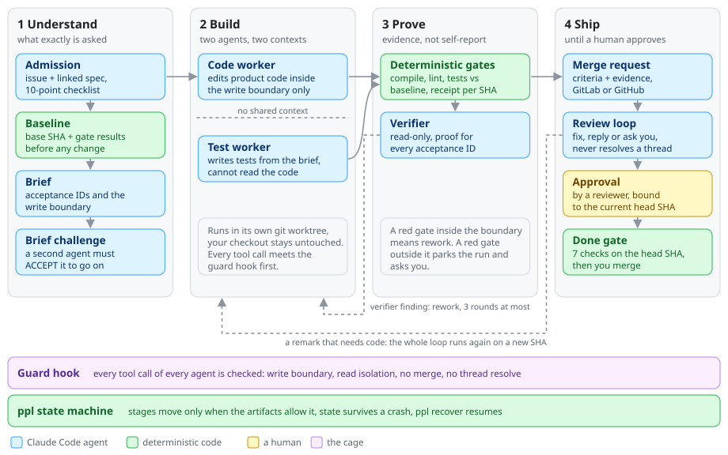
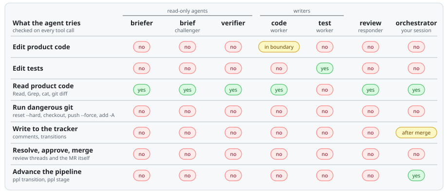
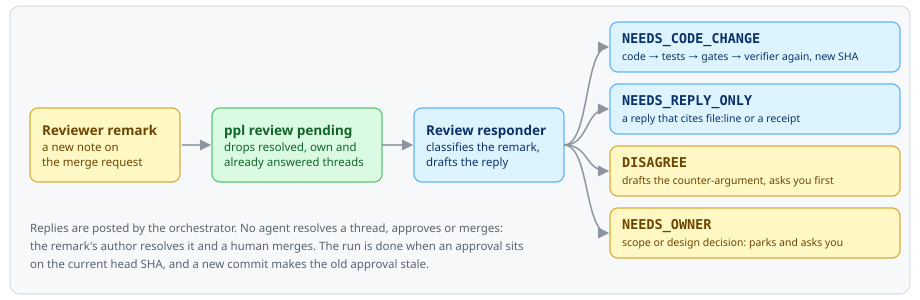
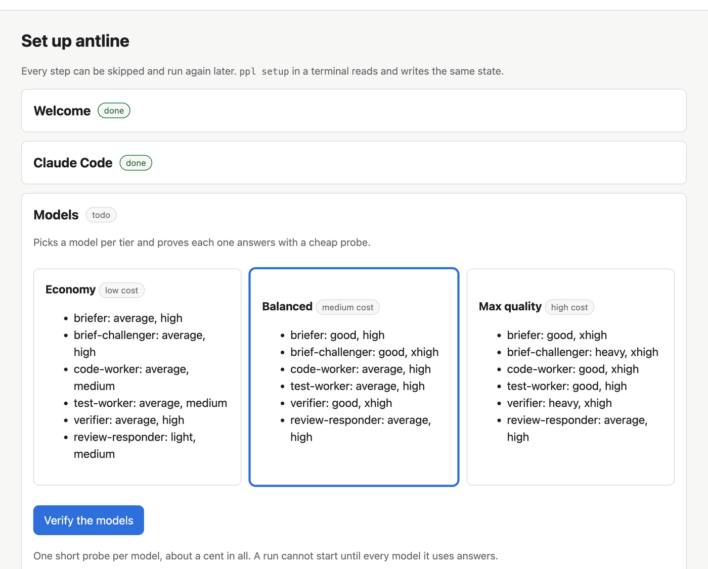
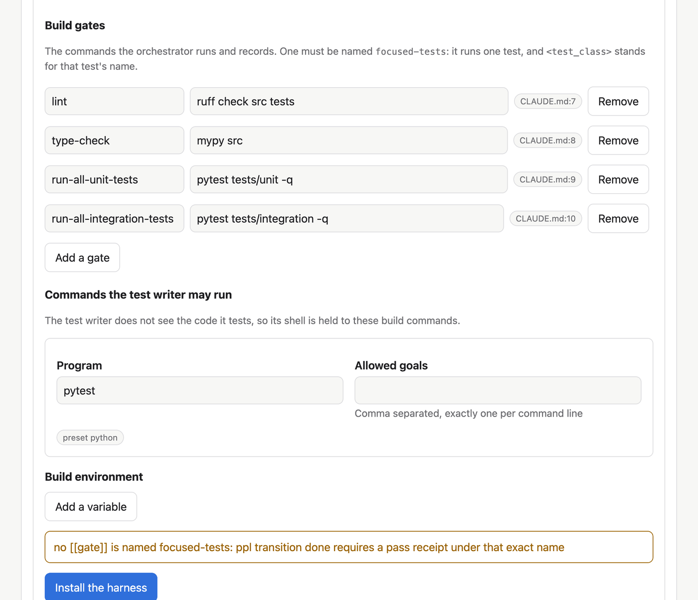
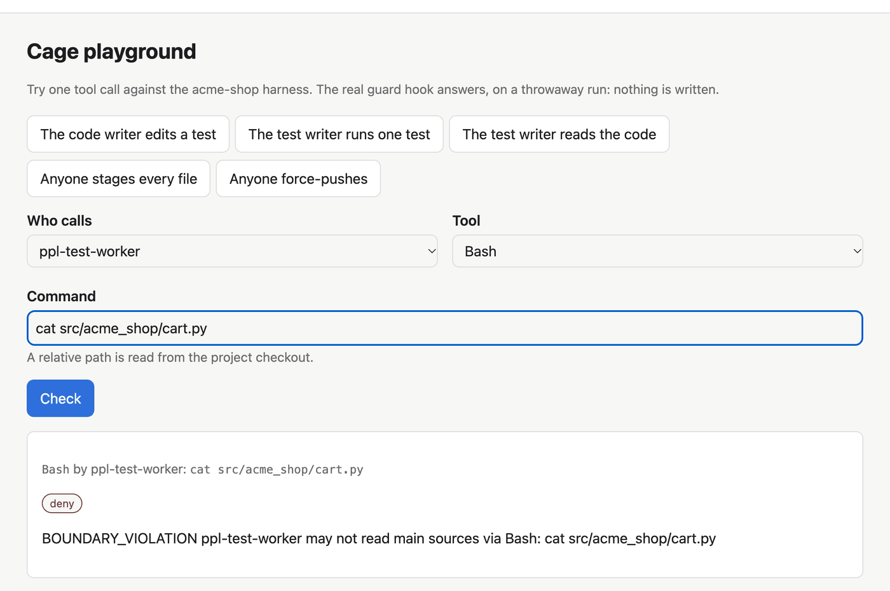

# antline

**Give it a tracker issue. Get back a reviewed merge request that a human has approved.**

antline runs Claude Code as a small crew of single-purpose agents. One agent writes
the code, a different one writes the tests from the acceptance criteria without seeing
that code, a third checks the result, and none of them decides on its own that the work
is done: deterministic code checks the evidence before the run moves on. The agents
work inside a cage. A PreToolUse hook denies every write outside a role's boundary
[R-ROLE-CODE-WORKER-BOUNDARY], every read the test worker must not make
[R-TEST-WORKER-READ-TOOLS], and the forge actions a human must perform
[R-MCP-RESOLVE-THREAD]. A bracketed ID like these names a row of `rules.toml`, and the
test suite fails if a blocking row has no test that asserts the refusal.

<picture>
  <source media="(prefers-color-scheme: dark)" srcset="docs/images/pipeline-dark.svg">
  
</picture>

## What you get

- **One command from issue to merge request.** Type `/pipeline KEY-123` in Claude Code.
  antline admits the task, records a baseline, writes and challenges a brief, implements,
  tests, runs your build gates, verifies, opens the merge request and answers reviewers
  until one of them approves.
- **Tests that can catch the code's mistakes.** The test writer gets the behavior and the
  acceptance criteria, not the implementation, and the guard hook denies its reads of
  product code [R-TEST-WORKER-READ-TOOLS] [R-TEST-WORKER-BASH-READS]. Its tests do not
  inherit the implementation's blind spots.
- **Hard limits instead of polite prompts.** Every tool call of every agent goes through
  a hook that knows which role made it. The code writer edits only inside the brief's write
  boundary, and the hook refuses a test file from it [R-ROLE-CODE-WORKER-TESTS].
  Read-only roles write nothing [R-ROLE-READONLY-NO-WRITE].
- **Done means proven, not claimed.** Every gate result is a receipt bound to a git SHA.
  `ppl transition done` refuses until seven checks hold on the head commit [R-DONE-GATE]:
  a PASS verdict, a passing receipt for every acceptance ID, a diff inside the boundary,
  no open blocking finding, a secret scan and the rest.
- **A review loop that answers reviewers.** Each new remark gets exactly one outcome: a fix
  that goes through the whole loop again, a reply that cites `file:line` or a receipt, or a
  question to you when the agent disagrees or the remark needs a decision.
- **You stay in charge of the irreversible parts.** The hook denies resolving a reviewer's
  thread and merging to every session, the orchestrator included [R-MCP-RESOLVE-THREAD]
  [R-MCP-MERGE-MR] [R-FORGE-GH-NO-APPROVE-MERGE], and it holds tracker writes back until
  the merge is observed [R-JIRA-GATE].
- **Runs that survive a crash.** State lives on disk, `ppl recover` picks a run up after a
  restart, and a run that hits something it should not decide parks with a code and a
  question for you.
- **Models routed per role.** Strong models where the solution space is wide (the brief,
  the verification), cheaper ones on rails (code, tests), with Economy, Balanced and Max
  quality presets. A run refuses to start on a model that has not answered a probe
  [R-INIT-MODELS-VERIFIED].
- **A browser studio for setup.** `ppl serve --open` walks the six setup steps, drafts your
  project's harness from its `CLAUDE.md` for a fraction of a cent, and lets you fire
  tool calls at the real guard hook.
- **Nothing installed into your project.** Python 3.11 standard library only. The code lives
  in a git clone, the data under `~/.ppl`, the agents in a separate workspace. Your
  repository gets a branch and a merge request.

## Why it is different

| | One agent in a loop | antline |
|---|---|---|
| Who writes the tests | the agent that wrote the code | a second agent with no read access to the code [R-TEST-WORKER-READ-TOOLS] |
| What "done" means | the model says it is done | seven checks pass on the head commit [R-DONE-GATE] |
| What keeps it in scope | the prompt | a hook on every tool call [R-ROLE-CODE-WORKER-BOUNDARY] |
| Reviewer remarks | you paste them back | classified, then fixed, answered or brought to you |
| A crash halfway through | start over | `ppl recover` resumes from the state on disk |
| Who merges | whatever the agent decides | a human, the hook denies the merge to agents [R-MCP-MERGE-MR] |

## How it works

### The cage

<picture>
  <source media="(prefers-color-scheme: dark)" srcset="docs/images/cage-dark.svg">
  
</picture>

The cells are the guard hook's own answers: each call was sent through
`hooks/ppl_guard.py` from the studio's cage playground. The orchestrator's tracker
writes open once the run reaches the merge watch [R-JIRA-GATE]. The read-only agents
also get no Edit, Write or Bash tool in their agent files [R-ROLE-TOOLS-READONLY].
The hook has to be registered first, and until it is, nothing in the cage is enforced
[R-GUARD-NOT-ARMED n/a].

### The review loop

<picture>
  <source media="(prefers-color-scheme: dark)" srcset="docs/images/review-loop-dark.svg">
  
</picture>

### The studio

Pick a model preset, and each model answers a cheap probe before a run uses it:



Claude reads your `CLAUDE.md` and drafts the build gates. Each field shows the line it
came from, and you review the form before anything is installed:



The cage playground sends one tool call through the real hook on a throwaway run. Here
the test writer tries to `cat` product code and the hook denies it
[R-TEST-WORKER-BASH-READS]:



## Pros and cons

**Pros**

- Independent tests by construction, not by a line in a prompt.
- The limits that matter are code. `rules.toml` holds 158 rules, 114 of them blocking,
  and `tests/test_rule_matrix.py` ties every blocking rule to a test that asserts the
  refusal. The suite has 1868 tests, and `tools/cage_check.py` drives the hook the way
  Claude Code does.
- Irreversible steps stay with people: merging, resolving threads, approving, and any
  disagreement with a reviewer.
- Crash-safe and resumable, and it parks with a question instead of guessing.
- Cost control per role: cheaper tiers for the workers, the strong tier where it pays.
- No dependencies, nothing committed to your repository, GitLab and GitHub both work.

**Cons**

- One task at a time. Parallel lanes are not built yet.
- Claude only. All agents share one model family, so their blind spots are correlated.
  The provider-neutral contract exists, the adapters for other providers do not.
- The test/main split knows Java and Maven layouts only: `src/test/**`, `*Test.java`,
  `*IT.java`, `*Tests.java`. On other stacks the hook takes test files for product code,
  so it refuses them to the test writer [R-ROLE-TEST-WORKER-MAIN] and lets the code writer
  edit them inside its boundary, until those patterns become configurable.
- Jira is the only tracker, through the Atlassian MCP server.
- A worktree is not a sandbox. A process can still read credentials or write outside the
  tree if the operating system lets it.
- The done gate mostly checks documents the same session wrote. SHA binding and
  consistency checks catch drift and omissions, but a model that is wrong in a
  self-consistent way passes. Real independence needs CI or a verifier on separate
  credentials.
- More tokens than one agent. Six roles, high effort on the brief and the verification,
  and long runs can hit subscription rate limits and park.
- It ends at approval and a human merges. That is deliberate, and it is not hands-off.
- No packaged installer: a git clone plus `ppl setup`.
- The cage is proven at hook level. An end-to-end run against your own tracker, forge and
  reviewers is yours to make.

## Get started

`docs/DESIGN.md` is the specification. The rest of this file is how to install and use it.

## Requirements

- Python 3.11 or newer, no packages.
- Claude Code (`claude` on PATH, logged in).
- git.
- A git forge: GitLab through a GitLab MCP server, or GitHub through `gh`.
- Jira through the Atlassian MCP server for the tracker.

## Install

```bash
git clone https://github.com/Nomad06/antline ~/antline
export PATH="$HOME/antline/bin:$PATH"     # add this line to your shell profile
ppl setup
```

The supported install is the clone with `bin/` on `PATH`: `bin/ppl` points ppl at
the checkout, where `defaults/`, `templates/` and `skill/` live. An editable dev
install (`pip install -e .`) also works from the clone.

`ppl setup` walks six steps - paths, claude, models, harness, forge, apply -
each skippable with `s` and re-runnable with `ppl setup <step>`: the data root
(`~/.ppl`), the hooks in an isolated workspace (`~/ppl-workspace` by default),
a model per tier verified by a cheap probe, your harness from an example, the
forge check, and the agent files and skill. `ppl init` refuses a run until
`ppl setup` has recorded models, harness and apply as done [R-INIT-SETUP-COMPLETE],
`--skip-model-check` waives models, and a harness only added and applied by hand
gets `SETUP_INCOMPLETE` naming the `ppl setup` step to run.

## Studio

`ppl serve --open` starts the studio on `http://127.0.0.1:8787` and opens it in your browser,
`ppl setup --web` opens it straight on the setup wizard, and a first `ppl setup` in a terminal
offers it. The wizard runs the same six steps as `ppl setup`, records them in the same
`config.toml` and writes the same files, so you can start in one and finish in the other.

On the Project and harness screen the studio looks at your checkout. When it has a
`CLAUDE.md` or `AGENTS.md`, one short Claude call on your lightest model tier reads them and
drafts the gates, the commands the test writer may run and the build environment (a few
cents). Otherwise, or when that call fails, the draft starts from a preset for the stack your
build files name: npm, Python, Maven, Gradle, Go, Cargo or Make. You review every field in a
form before anything is installed, with the source of each field shown beside it.

The Models screen offers three presets, a tier and an effort per role: Economy, Balanced
and Max quality. The same presets are `ppl routing preset economy|balanced|max`.

The studio listens on loopback only. Every request needs the session token in the link
`ppl serve` prints [R-STUDIO-SESSION-TOKEN].

After setup the studio has three more pages. **Agents** sets the model tier and effort per
role (or a preset for all of them), shows each role's base prompt beside its project notes
and the agent file apply would write, and lists the blocking rules of the cage that cover that
role, which hold whatever its prompt says once the guard hook is registered
[R-GUARD-NOT-ARMED n/a]. **Harness** edits, adds and creates harnesses, and applies one, which
also makes it the active harness, as `ppl harness apply` does.

In Expert mode the Harness page adds a raw `harness.toml` editor and the fragments beside its
form, the Agents page adds the high-risk tier and the history of the notes and of
`routing.toml`, and **Playground** runs one tool call through the real guard hook against a
throwaway run. Every save from a form, an editor or a preset keeps the content it replaced in
`~/.ppl/studio/history/`, and Expert mode shows those versions with a restore for
`harness.toml`, the role notes and `routing.toml`. A save that would overwrite a file changed in
another tab or a terminal since the page loaded it is refused [R-STUDIO-CHANGED-ON-DISK].

## Hooks

`ppl setup claude` writes these into the workspace's `.claude/settings.local.json`
(answer `global` or `manual` and it prints them for you to paste):

```json
{"hooks": {
  "PreToolUse": [{"matcher": ".*", "hooks": [{"type": "command",
    "command": "/path/to/python3.11 /path/to/antline/hooks/ppl_guard.py", "timeout": 5}]}],
  "SubagentStart": [{"matcher": "", "hooks": [{"type": "command",
    "command": "/path/to/python3.11 /path/to/antline/hooks/ppl_dispatch.py", "timeout": 5}]}]}}
```

The interpreter in those commands has to be Python 3.11 or newer, and `ppl setup
claude` writes the one that ran it, so the hooks do not depend on which `python3`
the `PATH` Claude Code spawns them with finds first. Under an older interpreter the
guard denies every role call [R-GUARD-PYTHON-FLOOR], and `ppl doctor` reports
`hook_runs: false` with the remedy.

The recommended matcher is `.*`, so the guard sees every call. `ppl init` refuses
a run under a matcher that leaves a guarded tool name uncovered [R-GUARD-MATCHER].
Those names carry the default tracker prefixes and forge server names only, so an
explicit matcher plus a custom `tracker.mcp_prefixes` or `forge.mcp_server` needs
those names covered by hand. `ppl init` also refuses an isolated run while the
guard is in `~/.claude/settings.json` [R-INIT-ISOLATION-CHECK], so if you answered
`global` in `ppl setup claude`, start runs with `ppl init --no-isolated`. Until the
hooks are registered, nothing in the cage is enforced [R-GUARD-NOT-ARMED n/a].

## Harness

A harness is a directory under `~/.ppl/harnesses/<name>/` holding everything
that belongs to one project: `harness.toml` (repo path, task key pattern,
tracker and forge settings, build gates, the command shapes the test worker
may run), `skill/` fragments and `templates/` overlays. Two examples ship in
`defaults/harnesses/`: `example-maven` (GitLab, Maven) and `example-generic`
(GitHub, make). Keep yours in its own git repository and install it with
`ppl harness add <name> --source <directory or git url>`.

```bash
ppl harness validate <name>
ppl harness apply <name>      # renders the agents and the skill, makes it active
```

The `skill/` fragments a harness can carry are `gates.md` (notes in front of the
gate recipes), `extra-gates.md` (project-specific gate steps), `baseline.md` (what
to record before any change) and `tracker-close.md` (the note written to the
tracker once the merge is observed, by default a short comment saying what was
done and how to check it). In a fragment, `<default-branch>` is replaced with
`repo.default_branch` when the skill is rendered, while `<worktree>`, `<TASK-ID>`,
`<SHA>` and `<GENERATION>` are left for the orchestrator to fill in at run time.

`ppl harness apply <name>` re-renders the agent files and the skill, so run it
after any harness or routing change. A harness's `tracker.mcp_prefixes`
replaces the default Atlassian prefixes rather than extending them: list every
prefix your tracker server is registered under. `ppl harness validate` warns when
the list keeps none of the defaults.

## Models

`~/.ppl/routing.toml` names a model per tier (`heavy`, `good`, `average`,
`light`) and a tier per role, see `defaults/routing.example.toml`. `ppl models
status` shows what is verified. `ppl init` refuses to start a run while a model
it would route to is unverified or stale, `ppl models verify` fixes that, and
`--skip-model-check` records that you chose not to [R-INIT-MODELS-VERIFIED].
After changing a tier, run `ppl models verify` and `ppl harness apply <name>`.
`ppl routing apply` re-renders the agent files alone, for `--harness <name>` or
the active harness. A role can carry `by_risk = { high = "good" }`, used for
runs started with `ppl init --risk high` [R-ROUTING-BY-RISK].

## Run a task

```bash
cd ~/ppl-workspace
claude
> /pipeline https://tracker.example/browse/KEY-123
```

The orchestrator skill takes it from there: `ppl init --harness <name>`, a
worktree under the harness's `repo.worktrees`, the stages of `docs/DESIGN.md`
section 7, and a review loop until the MR is approved. A halt is a parked run
with a code and a question, see the skill's `references/escalation.md`.

## Watch and control it

```bash
ppl status
ppl serve --open     # the studio on http://127.0.0.1:8787, the run list at /runs
ppl recover          # always safe, always first after a restart
ppl doctor           # hooks, setup, models, harness, forge
ppl control set pause|resume|stop
```

Run `ppl doctor` and `ppl init` from the workspace: both read the hook
registration from `.claude/settings.local.json` in the current directory, and from
anywhere else doctor reports `registration: none`.

## Sandbox

Four variables keep an experiment out of your installation:

- `PPL_HOME` - the data root (default `~/.ppl`): config, routing, models, harnesses, runs.
- `PPL_CLAUDE_HOME` - where `ppl doctor` looks for Claude settings (default `~/.claude`).
- `PPL_AGENTS_DIR` - where `ppl harness apply` writes the agent files.
- `PPL_SKILLS_DIR` - where `ppl harness apply` writes the skill.

```bash
export PPL_HOME=$(mktemp -d) PPL_CLAUDE_HOME=$(mktemp -d)
export PPL_AGENTS_DIR=$PPL_HOME/workspace/.claude/agents
export PPL_SKILLS_DIR=$PPL_HOME/workspace/.claude/skills
ppl setup --answer workspace=$PPL_HOME/workspace
```

A `claude` session started in that workspace sees the sandbox agents and skill.
Export `PPL_HOME` in the shell that launches `claude` too, or the hooks read a
different data root than the CLI. Check that `data_root` in `ppl doctor`'s JSON
line is your temp dir.

## Tests

```bash
python3 -m unittest discover -s tests -q
python3 tools/cage_check.py
```

The rule matrix (`rules.toml`, `tests/test_rule_matrix.py`) ties every
enforcement claim in the documents to a row and every blocking row to a test
that asserts a refusal. Keep it green. `tools/cage_check.py` drives the guard
hook as a subprocess, the way Claude Code does.

## License

MIT, see `LICENSE`.
