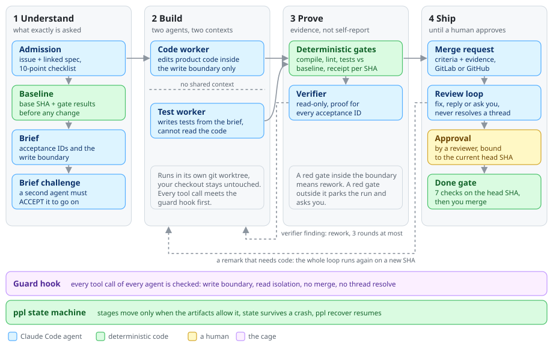
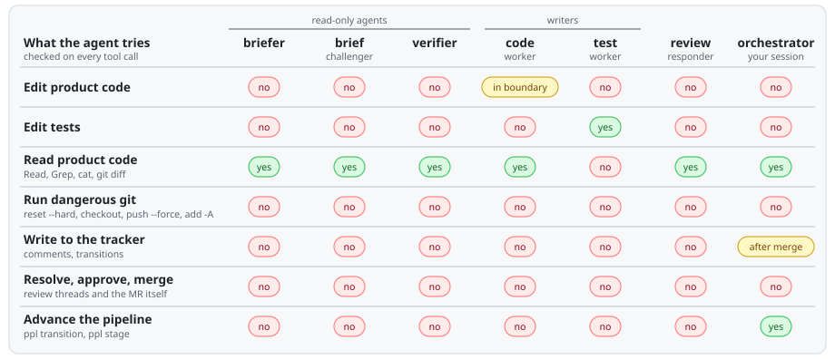
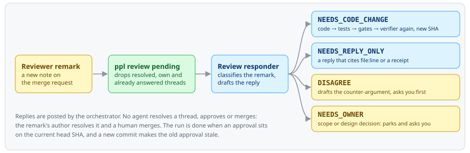
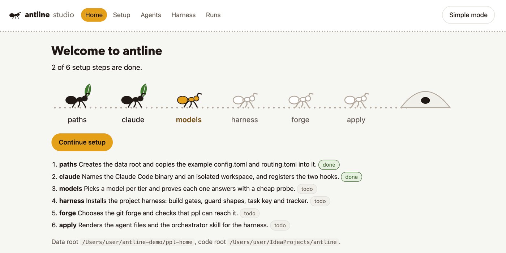
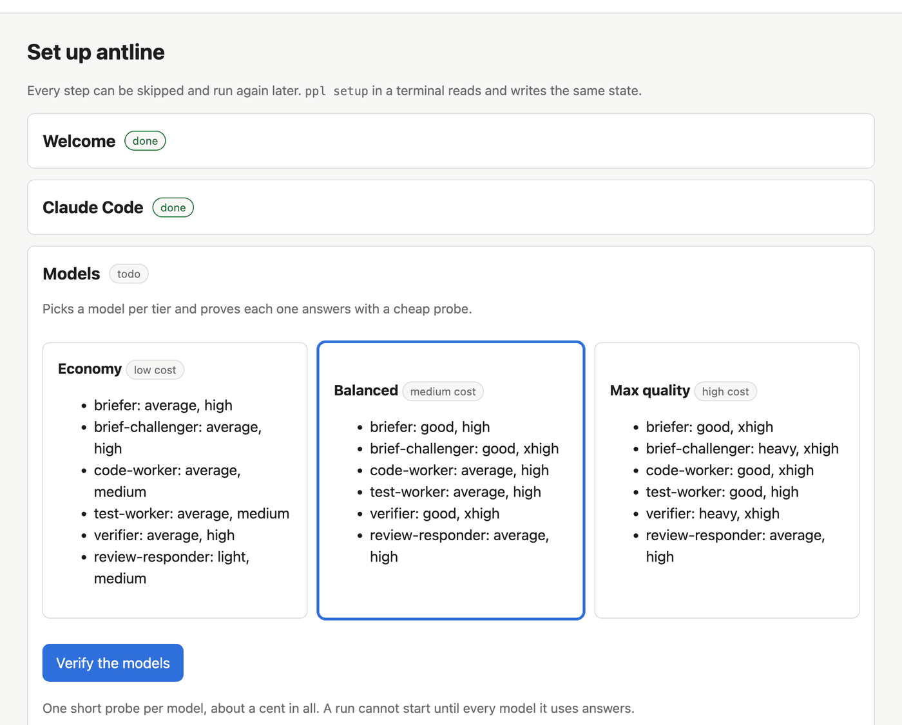
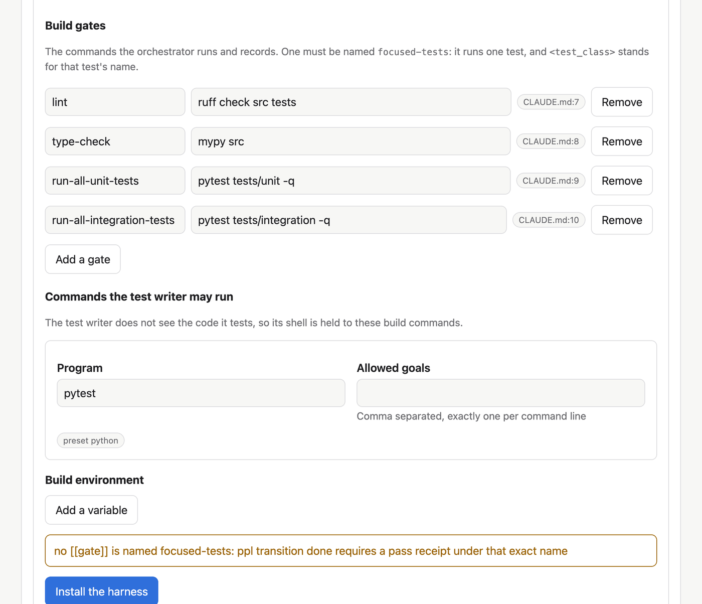
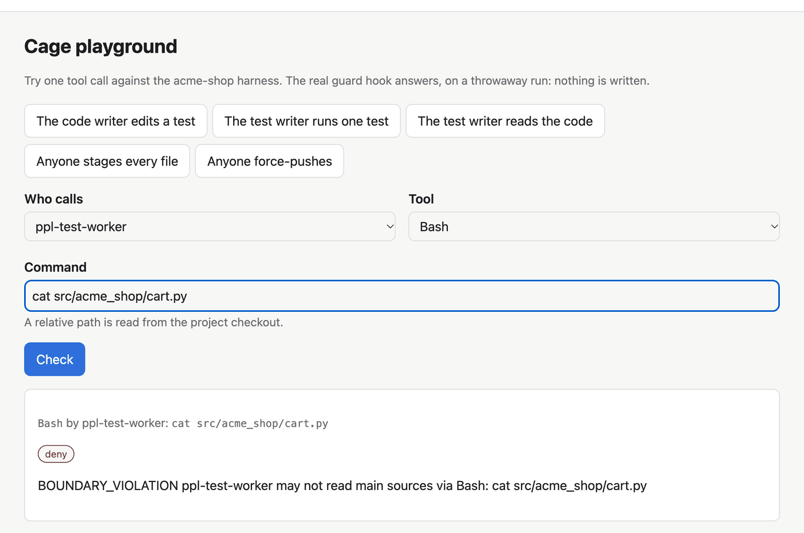

# antline

**Give it a tracker issue. Get back a reviewed merge request that a human has approved.**

antline runs Claude Code as a small crew of single-purpose agents. One agent writes
the code, a different one writes the tests from the acceptance criteria without seeing
that code, a third checks the result, and none of them decides on its own that the work
is done: deterministic code checks the evidence before the run moves on. The agents
work inside a cage. A PreToolUse hook denies every write outside a role's boundary
[R-ROLE-CODE-WORKER-BOUNDARY], every read the test worker must not make
[R-TEST-WORKER-READ-TOOLS], and the forge actions a human must perform
[R-MCP-RESOLVE-THREAD]. A bracketed ID like these names a row of `ppl/_assets/rules.toml`, and the
test suite fails if a blocking row has no test that asserts the refusal.

<picture>
  <source media="(prefers-color-scheme: dark)" srcset="docs/images/pipeline-dark.svg">
  
</picture>

## What you get

- **One command from issue to merge request.** Run `ppl lane <issue link>` in a terminal: it
  opens a Claude Code window for that one task, and antline admits the task, records a
  baseline, writes and challenges a brief, implements,
  tests, runs your build gates, verifies, opens the merge request and answers reviewers
  until one of them approves.
- **Tests that can catch the code's mistakes.** The test writer gets the behavior and the
  acceptance criteria, not the implementation, and the guard hook denies its reads of
  product code [R-TEST-WORKER-READ-TOOLS] [R-TEST-WORKER-BASH-READS]. The hook also denies
  a dispatch whose prompt pastes the diff or the lines the implementation added
  [R-TEST-WORKER-DISPATCH-LEAK]. Its tests do not inherit the implementation's blind spots.
- **Hard limits instead of polite prompts.** Every tool call of every agent goes through
  a hook that knows which role made it. The code writer edits only inside the brief's write
  boundary, and the hook refuses a test file from it [R-ROLE-CODE-WORKER-TESTS].
  Read-only roles write nothing [R-ROLE-READONLY-NO-WRITE].
- **Done means proven, not claimed.** Every gate result is a receipt bound to a git SHA.
  `ppl transition done` refuses until seven checks hold on the head commit [R-DONE-GATE]:
  a PASS verdict, a passing receipt for every acceptance ID, a diff inside the boundary,
  no open blocking finding, a secret scan and the rest.
- **A review loop that answers reviewers.** Each new remark gets exactly one outcome: a fix
  that goes through the whole loop again, a reply that cites `file:line` or a receipt, or a
  question to you when the agent disagrees or the remark needs a decision.
- **You stay in charge of the irreversible parts.** The hook denies resolving a reviewer's
  thread and merging to every session, the orchestrator included [R-MCP-RESOLVE-THREAD]
  [R-MCP-MERGE-MR] [R-FORGE-GH-NO-APPROVE-MERGE], and it holds tracker writes back until
  the merge is observed [R-JIRA-GATE].
- **Runs that survive a crash.** State lives on disk, `ppl recover` picks a run up after a
  restart, and a run that hits something it should not decide parks with a code and a
  question for you.
- **Lessons from finished runs.** After a merge, a read-only reflector reads the run's evidence and
  proposes lessons for the harness. You accept, edit or reject each one, and none reaches an agent
  before you accept it and commit it in the harness repository.
- **Models routed per role.** Strong models where the solution space is wide (the brief,
  the verification), cheaper ones on rails (code, tests), with Economy, Balanced and Max
  quality presets. A run refuses to start on a model that has not answered a probe
  [R-INIT-MODELS-VERIFIED].
- **A browser studio for setup.** `ppl serve --open` walks the six setup steps, drafts your
  project's harness from its `CLAUDE.md` for a fraction of a cent, and lets you fire
  tool calls at the real guard hook.
- **Several tasks at once.** Each task runs in its own lane: its own window, worktree, branch,
  hooks and agents. Three lanes run at once by default, one per harness unless the harness
  says its gates can share the machine [R-LANE-RESOURCE-ISOLATION].
- **Nothing installed into your project.** Python 3.11 standard library only. The code lives
  in the installed package or a git clone, the data under `~/.ppl`, each lane's agents, skill
  and hooks in its own directory there. Your repository gets a branch and a merge request.

## Why it is different

| | One agent in a loop | antline |
|---|---|---|
| Who writes the tests | the agent that wrote the code | a second agent with no read access to the code [R-TEST-WORKER-READ-TOOLS] |
| What "done" means | the model says it is done | seven checks pass on the head commit [R-DONE-GATE] |
| What keeps it in scope | the prompt | a hook on every tool call [R-ROLE-CODE-WORKER-BOUNDARY] |
| Reviewer remarks | you paste them back | classified, then fixed, answered or brought to you |
| A crash halfway through | start over | `ppl recover` resumes from the state on disk |
| Who merges | whatever the agent decides | a human, the hook denies the merge to agents [R-MCP-MERGE-MR] |

## How it works

### The cage

<picture>
  <source media="(prefers-color-scheme: dark)" srcset="docs/images/cage-dark.svg">
  
</picture>

The cells are the guard hook's own answers: each call was sent through
`ppl/_assets/hooks/ppl_guard.py` from the studio's cage playground. The orchestrator's tracker
writes open once the run reaches the merge watch and `ppl merge observed` has recorded the
merge [R-JIRA-GATE]. The read-only agents
also get no Edit, Write or Bash tool in their agent definitions [R-ROLE-TOOLS-READONLY].
Roles run only in a lane session, the window `ppl lane` starts with the run's own hooks: a
`ppl-*` role anywhere else is refused [R-LANE-ROLE-OUTSIDE], and a lane session resumed by hand
without the lane flags (`claude --resume`) has no guard at all [R-LANE-BARE-RESUME n/a].

### The review loop

<picture>
  <source media="(prefers-color-scheme: dark)" srcset="docs/images/review-loop-dark.svg">
  
</picture>

### The studio

Home shows setup as a trail to the nest: each step is an ant, a done step's ant carries a
leaf, and the amber ant is the step to do next:



Each setup step is a stop on the same trail. Pick a model preset, and each model answers a
cheap probe before a run uses it:



Claude reads your `CLAUDE.md` and drafts the build gates. Each field shows the line it
came from, and you review the form before anything is installed:



The cage playground sends one tool call through the real hook on a throwaway run. Here
the test writer tries to `cat` product code and the hook denies it
[R-TEST-WORKER-BASH-READS]:



## Pros and cons

**Pros**

- Independent tests by construction, not by a line in a prompt.
- The limits that matter are code. `ppl/_assets/rules.toml` holds 205 rules, 159 of them blocking,
  and `tests/test_rule_matrix.py` ties every blocking rule to a test that asserts the
  refusal. The suite has 3318 tests, and `tools/cage_check.py` drives the hook the way
  Claude Code does.
- `ppl metrics` warns when its numbers point at a broken setup, such as a verifier that passes
  everything or a role that keeps hitting the cage, and `ppl metrics --text` prints it as plain lines.
- `ppl trail export --task <id> --out <dir>` writes one run as a static trail to publish: its
  documents from an allowlist, paths and people redacted (URLs on request), and a `MANIFEST.json`
  with hashes, wall-clock, tokens per role, denials and rework rounds. It refuses a trail that
  still holds the repo path, the home directory, a person or a token [R-TRAIL-REDACTED].
- Irreversible steps stay with people: merging, resolving threads, approving, and any
  disagreement with a reviewer.
- Crash-safe and resumable, and it parks with a question instead of guessing.
- Cost control per role: cheaper tiers for the workers, the strong tier where it pays.
- No dependencies, nothing committed to your repository, GitLab and GitHub both work.

**Cons**

- Lanes share the machine. A worktree separates files and nothing else, so a harness runs one
  lane at a time unless you raise its `[lanes] max`, and then nothing checks that its gates
  keep test databases, ports and queues apart [R-LANE-RESOURCE-ISOLATION].
- Claude only. All agents share one model family, so their blind spots are correlated.
  The provider-neutral contract exists, the adapters for other providers do not.
- The test/main split comes from the harness's `[tests]` globs (the Java and Maven
  defaults when it has none), and the split is by path, so tests inside product files
  (Rust `#[cfg(test)]`, doctests) are not isolated.
- A worktree is not a sandbox. On a GitHub harness Claude Code's OS sandbox confines GitHub
  access and writes from Bash, and nothing else: other network and most reads are open, and
  Windows has no OS sandbox (see Credential separation).
- Without the OS sandbox (`--no-os-sandbox`, or Windows) the `gh` tracker gate reads only the
  command's words, so a renamed binary, an API host held in a variable, an interpreter or a
  script file is not seen. The boundary that closes this is a GitHub credential the role
  sessions never hold [R-TRACKER-CLI-GATE].
- The done gate mostly checks documents the same session wrote. SHA binding and
  consistency checks catch drift and omissions, but a model that is wrong in a
  self-consistent way passes. Real independence needs CI or a verifier on separate
  credentials.
- More tokens than one agent. Seven roles, high effort on the brief and the verification,
  and long runs can hit subscription rate limits and park.
- It ends at approval and a human merges. That is deliberate, and it is not hands-off.
- The cage is proven at hook level. An end-to-end run against your own tracker, forge and
  reviewers is yours to make.

## Get started

`docs/DESIGN.md` is the specification. The rest of this file is how to install and use it.

## Requirements

- Python 3.11 or newer, no packages.
- Claude Code (`claude` on PATH, logged in).
- git.
- A git forge: GitLab through a GitLab MCP server, or GitHub through `gh`.
- A tracker: Jira through the Atlassian MCP server, or GitHub Issues through `gh`.

## Install

```bash
pipx install git+https://github.com/Nomad06/antline
ppl demo
```

`pipx install` needs Python 3.11 or newer, the same floor as the rest of antline.
There is no PyPI package yet, so the install reads the repository.

`ppl demo` plays one issue through the real `ppl` and the real guard hook in a few
seconds. It runs offline in a throwaway sandbox (its own `HOME`, data root, sample git repo
and a stand-in for `gh`) and starts the task the way you would, with `ppl lane`, taking the
launch line instead of opening Claude Code. The agents are scripted stand-ins, so it
spends no tokens and leaves your `~/.ppl` and your `~/.claude` alone. Each step prints
one line: who acts, what they do, the answer and the rule behind it. Several of the
answers are refusals, among them:

- The code worker edits a test file and the guard says no [R-ROLE-CODE-WORKER-TESTS].
- The orchestrator dispatches the test worker with the implementation pasted into the
  prompt and the dispatch is denied [R-TEST-WORKER-DISPATCH-LEAK].
- `gh issue close` runs before the merge is observed and the guard holds it back
  [R-TRACKER-CLI-GATE].

`ppl demo --keep` leaves the sandbox in place and prints where it is.

Then set up for real with `ppl serve --open` (the studio) or `ppl setup` (the terminal).

### Upgrading

Upgrade with `pipx reinstall antline`, which installs the current `main` again.
`pipx upgrade antline` can answer "already at latest version" and change nothing, since
the version number stays the same between merges. `ppl lane` writes each lane's hook
commands with absolute paths to this install's hook scripts and the interpreter that runs it,
so a lane started after the reinstall uses the new install. A lane started before a
reinstall, or a `git pull`, that moved files keeps the old paths: every tool call in it fails
with `can't open file '.../hooks/ppl_guard.py'`, and `ppl doctor --task <id>` names the hook
path that no longer exists. Finish it, or destroy it with `ppl destroy --scope local --task
<id>` in a terminal, and start it again with `ppl lane <link>`. The hook commands also name the
interpreter that ran `ppl lane`. If that interpreter goes away, as a pipx venv's does when its
base Python is removed, the shell exits 127, which Claude Code reads as a non-blocking error,
and every call in the lane is allowed: `ppl lane resume` refuses `SETUP_INCOMPLETE` while a
hook's interpreter or script is gone or the interpreter is older than 3.11, and `ppl doctor
--task <id>` lists the same under `lane_hooks` [R-GUARD-PYTHON-FLOOR]. Put a Python 3.11 or
newer back at that path, or start the lane again.

Coming from a ppl that rendered into one workspace (`~/ppl-workspace`), run `ppl setup
claude` once: it takes back the hook entries, sandbox block, skill and `ppl-*` agents that ppl
wrote there, each matched by ppl's own markers, and leaves them while a run started before
lanes is unfinished.

### From a clone (contributors)

```bash
git clone https://github.com/Nomad06/antline ~/antline
export PATH="$HOME/antline/bin:$PATH"     # add this line to your shell profile
ppl setup
```

`bin/ppl` runs the checkout, whose `ppl/_assets/` holds `defaults/`, `templates/`
and `skill/`. An editable install (`pip install -e .`) also works from the clone.

### The setup steps

`ppl setup` walks six steps - paths, claude, models, harness, forge, apply -
each skippable with `s` and re-runnable with `ppl setup <step>`: the data root
(`~/.ppl`), the Claude Code binary, a model per tier verified by a cheap probe, your
harness from an example, the forge and the tracker (GitHub Issues for a GitHub forge, Jira
for GitLab, each checked), and the default harness for `ppl lane`, checked at its commit.
Setup writes no hooks, agents or skill: `ppl lane` renders those for each task when it starts
one. `ppl init` refuses a run until
`ppl setup` has recorded models, harness and apply as done [R-INIT-SETUP-COMPLETE],
`--skip-model-check` waives models, and a harness only added and applied by hand
gets `SETUP_INCOMPLETE` naming the `ppl setup` step to run.

## Studio

`ppl serve --open` starts the studio on `http://127.0.0.1:8787` and opens it in your browser,
`ppl setup --web` opens it straight on the setup wizard, and a first `ppl setup` in a terminal
offers it. The wizard runs the same six steps as `ppl setup`, records them in the same
`config.toml` and writes the same files, so you can start in one and finish in the other.

On the Project and harness screen the studio looks at your checkout. When it has a
`CLAUDE.md` or `AGENTS.md`, one short Claude call on your lightest model tier reads them and
drafts the gates, the commands the test writer may run and the build environment (a few
cents). Otherwise, or when that call fails, the draft starts from a preset for the stack your
build files name: npm, Python, Maven, Gradle, Go, Cargo or Make. You review every field in a
form before anything is installed, with the source of each field shown beside it.
A draft made from the same files, model and Claude version is reused at no cost, the screen
says so, and "Draft again (new call)" asks Claude again. Reuse needs the model of the lightest
tier verified by `ppl models verify`, otherwise every draft is a new call.

The Models screen offers three presets, a tier and an effort per role: Economy, Balanced
and Max quality. The same presets are `ppl routing preset economy|balanced|max`.

The studio listens on loopback only. Every request needs the session token in the link
`ppl serve` prints [R-STUDIO-SESSION-TOKEN].

After setup the studio has four more pages. **Agents** sets the model tier and effort per
role (or a preset for all of them), shows each role's base prompt beside its project notes
and the agent a lane would get, and lists the blocking rules of the cage that cover that
role, which hold whatever its prompt says in a lane session [R-LANE-HOOK-BINDING].
**Harness** edits, adds and creates harnesses, and applies one, which
checks it at its commit and makes it the default harness for `ppl lane`, as `ppl harness apply`
does. A save writes the installed harness's checkout, so commit the change there: `ppl lane`
refuses a harness with uncommitted changes [R-MEMORY-APPLIED]. **Lanes** lists the running
lanes, each with its stage, its spend and the command that reopens its window, beside the
machine's lane limit and the day's spend.

In Expert mode the Harness page adds a raw `harness.toml` editor and the fragments beside its
form, the Agents page adds the high-risk tier and the history of the notes and of
`routing.toml`, and **Playground** runs one tool call through the real guard hook against a
throwaway run. Every save from a form, an editor or a preset keeps the content it replaced in
`~/.ppl/studio/history/`, and Expert mode shows those versions with a restore for
`harness.toml`, the role notes and `routing.toml`. A save that would overwrite a file changed in
another tab or a terminal since the page loaded it is refused [R-STUDIO-CHANGED-ON-DISK].

## Hooks

`ppl lane` writes three hooks into each lane's `settings.json`, in the lane's start directory
`~/.ppl/lanes/<TASK-ID>/`, and the lane's Claude Code session loads them with `--settings`.
You register nothing by hand:

```json
{"hooks": {
  "PreToolUse": [{"matcher": ".*", "hooks": [{"type": "command",
    "command": "/path/to/python3.11 /path/to/site-packages/ppl/_assets/hooks/ppl_guard.py --task KEY-123", "timeout": 5}]}],
  "SubagentStart": [{"matcher": "", "hooks": [{"type": "command",
    "command": "/path/to/python3.11 /path/to/site-packages/ppl/_assets/hooks/ppl_dispatch.py --task KEY-123", "timeout": 5}]}],
  "SubagentStop": [{"matcher": "", "hooks": [{"type": "command",
    "command": "/path/to/python3.11 /path/to/site-packages/ppl/_assets/hooks/ppl_usage.py --task KEY-123", "timeout": 5}]}]}}
```

The paths are the ones `ppl lane` finds for your install: under pipx the scripts sit in its
venv, at `.../site-packages/ppl/_assets/hooks/ppl_guard.py`, and in a clone under the
checkout's `ppl/_assets/hooks/`. Every hook knows its run from the `--task` at the end of its
own command line, never from shared state, so a hook acts on its own lane's run alone
[R-LANE-HOOK-BINDING]. The session starts with `--setting-sources local`, which keeps the
hooks of your `~/.claude/settings.json` and of a project's `.claude/settings.json` out of it:
a lane runs ppl's hooks, the managed settings' and whatever its start directory's
`.claude/settings.local.json` holds, a file ppl does not write.

The guard is the cage, the dispatch hook counts role dispatches, and the usage hook
records each role's and the orchestrator's tokens in the run's `log.jsonl` when a role
stops, never refusing or delaying a dispatch [R-USAGE-HOOK-CANNOT-BLOCK].

A dollar cap is opt-in: set `usd_max` under `[budgets]` in `~/.ppl/config.toml` and a price
for each model under `[prices."<model id>"]`. `ppl init` copies the cap and the prices into
the run, so an edit to either applies from the next run, and `ppl stage enter` and
`ppl transition` refuse with `BUDGET_EXHAUSTED` once the manual `usd_used` plus the run's
priced usage reaches it [R-BUDGET-USD-CAP], or with `OWNER_DECISION` while a model it used
has no price [R-BUDGET-USD-UNPRICED]. `ppl park` stays available. `usd_max_per_day` under
`[budgets]` caps what every run on the machine spends since local midnight, and `ppl lane`
refuses to start at it as well [R-BUDGET-USD-PER-DAY].

The interpreter in those commands has to be Python 3.11 or newer, and `ppl lane` writes the
one that runs it, so the hooks do not depend on which `python3` the `PATH` Claude Code spawns
them with finds first. Under an older interpreter the
guard denies every role call, and every other call but Read, Glob and Grep
[R-GUARD-PYTHON-FLOOR], and `ppl doctor` reports
`hook_runs: false` with the remedy.

`ppl lane` registers the matcher `.*`, so the guard sees every call, and `ppl init` refuses
a run whose registration leaves a guarded tool name uncovered [R-GUARD-MATCHER]. `ppl init`
runs inside the task's lane and refuses outside it [R-LANE-INIT-INSIDE]. A session whose ppl
hooks carry no task, such as one an older ppl's workspace still registers, has every `ppl-*`
role refused and no run-scoped rule enforced [R-LANE-ROLE-OUTSIDE].

`ppl doctor`, run in a lane, reports per settings file of the lane `dispatch_hook` and
`usage_hook` (registered or missing) and `hook_shape` (`ok` or what is wrong with the hook
entries: a `type` other than `"command"`, no `timeout`, an interpreter or hook script that is
not an absolute path to a file). `ppl init` refuses a run while the guard entry has such a
problem, and warns when the dispatch or the usage hook is missing or malformed, or when
a hook script is not the one under this install's `_assets/hooks` (a clone or an older
install left behind) [R-DOCTOR-HOOK-SHAPE]. Neither runs anything to judge the shape: the interpreter's
version is asked by `ppl doctor` when it runs the guard (`hook_runs`).

## Credential separation

In a run on a GitHub harness (a GitHub forge or the GitHub Issues tracker) that `ppl init`
recorded as OS-sandboxed, no role can reach GitHub. `ppl lane` writes an OS sandbox
profile into the lane's `settings.json`. Every pipeline Bash command then runs in Claude Code's OS sandbox
with `github.com` and every subdomain denied, which Claude Code enforces on macOS and Linux
[R-OS-SANDBOX-NETWORK]. A role's Bash call that asks to leave the sandbox is denied by the guard
[R-OS-SANDBOX-ROLE-NO-ESCAPE], a role's call to a GitHub MCP tool is denied
[R-FORGE-GH-MCP-NO-ROLE], and so is its WebFetch of a github.com URL
[R-WEBFETCH-GITHUB-NO-ROLE].

Only the unroled orchestrator leaves the sandbox, and only for one plain command on a `gh`, `git`
or `ppl` that `ppl lane` pinned, in a shape the guard lists, against the harness's own repository
[R-OS-SANDBOX-ORCHESTRATOR-SHAPE]. A fetch, push or branch delete also needs a repository whose
local git config runs nothing and points the remote at the forge repo, and carries fixed `-c`
words that turn off every program that config could run (a hook, an ssh command, a credential,
askpass, gpg, alternate-refs or fsmonitor program, automatic gc) and leave ssh the one
transport [R-OS-SANDBOX-GIT-CONFIG]. An https remote is of no use there, so give the
checkout an ssh remote. If the guard cannot decide such a call it denies it
[R-OS-SANDBOX-FAIL-CLOSED]. `ppl init` refuses
to start a GitHub run in a session that is not sandboxed this way, unless you pass
`--no-os-sandbox`, which the run records [R-OS-SANDBOX-INIT-REQUIRED]. `ppl doctor` shows
`os_sandbox.state`, which is `on` only when a probe through the session's proxy gets the deny
list's own 403, not any 403.

What this costs and leaves open:

- Run `ppl lane`, `ppl harness apply` and `ppl setup` from a terminal, not from a pipeline
  session: a lane's profile write-denies its start directory, the lane registry and ppl's own
  config and harnesses, which they write [R-OS-SANDBOX-PROTECTED-PATHS].

- While an OS sandbox profile is applied no guarded session can edit ppl's own source,
  `~/.claude` outside `projects` and `plans`, or a file outside the sandbox write scope with an
  edit tool [R-OS-SANDBOX-PROTECTED-PATHS]. The profile write-denies the same protected paths to
  sandboxed Bash, and `ppl harness validate` refuses an `[os_sandbox] allow_write` entry that is
  or holds the home directory or a protected path: list the narrower directories a build writes
  [R-OS-SANDBOX-PROTECTED-PATHS]. `ppl doctor` lists another settings file's write grant over a
  protected path, and any unix socket allowance, under `os_sandbox.undoing`.
- MCP servers run outside the OS sandbox and are not checked, so name no file-writing MCP
  server in a harness: a lane loads the servers its harness names, copied from your
  `~/.claude.json`, and no other [R-OS-SANDBOX-PROTECTED-PATHS].
- Another `PreToolUse` hook that sees Bash (a command rewriter such as sqz or rtk, from a
  settings source the lane loads or a plugin it enables) can rewrite a call, and whether that
  keeps or drops `dangerouslyDisableSandbox` is unverified. `ppl doctor` lists such hooks as
  `foreign_bash_hooks` and `ppl init` warns on a GitHub run: remove or disable them for
  pipeline sessions before a GitHub run.
- The profile keeps sandboxed commands from reading gh's config, git's credential store,
  `.netrc` and `~/.ssh`; set `[os_sandbox] allow_ssh_read = true` for a build that needs ssh
  [R-OS-SANDBOX-NETWORK]. Unset `GH_TOKEN`, `GITHUB_TOKEN`, `GH_ENTERPRISE_TOKEN`,
  `GITHUB_ENTERPRISE_TOKEN` and any variable holding a GitHub token for pipeline sessions:
  every sandboxed command inherits them, and `ppl doctor` and `ppl init` name each one, by
  name alone. What a role writes, commits and scratch bodies, the orchestrator
  publishes unread, and the macOS keychain may stay readable from the sandbox.
- Use a fine-grained personal access token limited to the one repository the pipeline works on
  for the pipeline's `gh` login. The orchestrator's `gh` holds that credential, so its reach
  is the token's reach.
- Windows has no OS sandbox: `ppl init` refuses there without `--no-os-sandbox`
  [R-OS-SANDBOX-INIT-REQUIRED]. Git LFS pushes are not supported under the sandbox, since a
  local LFS install sets filter keys the push check refuses [R-OS-SANDBOX-GIT-CONFIG].
- The orchestrator is still a model, and its stage gate still reads the command's words
  [R-TRACKER-CLI-GATE].

## Harness

A harness is a directory under `~/.ppl/harnesses/<name>/` holding everything
that belongs to one project: `harness.toml` (repo path, task key pattern,
tracker and forge settings, build gates, the command shapes the test worker
may run), `skill/` fragments and `templates/` overlays. Two examples ship in
`ppl/_assets/defaults/harnesses/`: `example-maven` (GitLab, Maven) and `example-generic`
(GitHub, make). Keep yours in its own git repository and install it with
`ppl harness add <name> --source <directory or git url>`: a git url is cloned, and a plain
directory is committed as a new git repository under your own git identity. A lane runs the
installed harness at a commit: origin's default branch after a fetch, or its local `HEAD`
without an origin.

```bash
ppl harness validate <name>   # --json prints {errors, warnings} as the studio shows them
ppl harness apply <name>      # checks it at its commit, makes it the default for ppl lane
```

`ppl harness validate` runs the check the studio runs [R-STUDIO-SAME-VALIDATION].
It refuses a harness with no `focused-tests` gate or one whose command lacks
`<test_class>` [R-HARNESS-FOCUSED-TESTS-REQUIRED], an unknown table or key in
`harness.toml` (it names the nearest known one, `[env]` takes any name), a gate
placeholder the orchestrator does not fill and your `skill/gates.md` or
`skill/extra-gates.md` does not name (a copy of the command itself does not
count), and a `templates/<role>.part` for an unknown
role [R-HARNESS-UNKNOWN-KEY]. It refuses a rendered `SKILL.md`, skill reference or agent
file over three times the size the examples rendered when the caps were measured and warns over
1.5 times [R-HARNESS-SIZE-CAP]. It also warns about a file under `skill/` or `templates/`
that nothing reads, a `knowledge.skills` name missing from the skills
directories, and a focused-tests command no `[[guard.shape]]` lets the test
worker run.

The `skill/` fragments a harness can carry are `gates.md` (notes in front of the
gate recipes), `extra-gates.md` (project-specific gate steps), `baseline.md` (what
to record before any change) and `tracker-close.md` (the note written to the
tracker once the merge is observed, by default a short comment saying what was
done and how to check it). In a fragment, `<default-branch>` is replaced with
`repo.default_branch` when the skill is rendered, while `<worktree>`, `<TASK-ID>`,
`<SHA>` and `<GENERATION>` are left for the orchestrator to fill in at run time.

A harness or routing change reaches the next lane `ppl lane` starts, which renders the
agents and the skill from the harness commit and `routing.toml` as they are then; a running
lane keeps what it started with. Commit a harness change in its repository, and push it when
it has an origin: `ppl lane` refuses a harness with uncommitted changes, and until harness
changes go through merge requests, `ppl lessons accept` and the studio's saves write the
installed checkout and need that commit too [R-MEMORY-APPLIED]. A harness's
`[lanes] max` (1 to 9, 1 by default) is how many lanes of it run at once: raise it only when
its gates keep their databases, ports and queues apart per lane, for instance with `<lane>`,
the lane's number, in a gate command or an `[env]` value [R-LANE-RESOURCE-ISOLATION]. A
harness's `tracker.mcp_prefixes`
replaces the default Atlassian prefixes rather than extending them: list every
prefix your tracker server is registered under. `ppl harness validate` warns when
the list keeps none of the defaults. A GitHub Issues tracker is `kind = "github-issues"`
with `repo` (owner/name) and an optional `task_prefix` (default `GH`, so tasks read
`GH-123`), and the studio's Tracker select switches a draft between the two kinds.

## Models

`~/.ppl/routing.toml` names a model per tier (`heavy`, `good`, `average`,
`light`) and a tier per role, see `ppl/_assets/defaults/routing.example.toml`. `ppl models
status` shows what is verified. `ppl init` refuses to start a run while a model
it would route to is unverified or stale, `ppl models verify` fixes that, and
`--skip-model-check` records that you chose not to [R-INIT-MODELS-VERIFIED].
After changing a tier, run `ppl models verify`; the next lane takes the new routing, and a
running lane keeps the copy it froze when it started, which `ppl routing show` prints there.
A role can carry `by_risk = { high = "good" }`, used for
runs started with `ppl init --risk high` [R-ROUTING-BY-RISK].

## Run a task

```bash
ppl lane https://tracker.example/browse/KEY-123
```

Run it in a terminal, one per task. `ppl lane` reserves a lane, makes the worktree
`<repo.worktrees>/<repo>-KEY-123` on a new branch `KEY-123-work` from a fresh default branch,
writes the lane's hooks, agents, skill and MCP config under `~/.ppl/lanes/KEY-123/`, and opens
Claude Code there with `/antline:pipeline <link>` as its first prompt. The orchestrator skill
takes it from there: `ppl init`, the stages of `docs/DESIGN.md` section 7, and a review loop
until the MR is approved. A halt is a parked run with a code and a question, see the skill's
`references/escalation.md`. Without `--harness <name>` the harness is the installed one whose
`[repo] path` holds the current directory, else the default one, and `--slug <slug>` names the
branch `KEY-123-<slug>`.

```bash
ppl lane list                 # every lane: task, harness, stage, window open or closed
ppl lane resume KEY-123       # reopen a lane's window with the flags it started with
```

Three lanes run at once by default (`[lanes] max` in `~/.ppl/config.toml`, 1 to 9), and one
lane per harness unless the harness raises its own `[lanes] max`: a lane past either limit is
refused `BUSY`, naming the lanes that hold the slots [R-LANE-RESOURCE-ISOLATION]. Reopen a lane
with `ppl lane resume`, not a bare `claude --resume`: without the lane's flags the session has
no guard, OS sandbox or ppl agents [R-LANE-BARE-RESUME n/a]. After the merge the orchestrator
frees its lane with `ppl lane close`, which keeps the start directory and the worktree. A run
started by a ppl from before lanes cannot be finished in a lane: its old hooks carry no
`--task`, so every `ppl-*` role is denied, and bare `ppl` no longer finds it
[R-LANE-LEGACY-RUN]. Finish it before
you upgrade, or destroy it with `ppl destroy --scope local --task <id>`; until then `ppl lane`
refuses, naming it [R-LANE-LEGACY-RUN].

What a lane leaves to you:

- `ppl destroy --scope local --task KEY-123` is your step, in a terminal outside the lane: it
  removes the lane's worktree, its branch while nothing of it was pushed, and its start
  directory, the session's own cwd, and archives the run, so the orchestrator asks you to run
  it, and under the OS sandbox it cannot run it itself [R-LANE-CROSS-WRITE].
- On a GitHub harness the lane's OS sandbox lets git write only what git in a worktree writes
  in the checkout's `.git`, so in a lane a git that rewrites `packed-refs` (deleting a packed
  branch, `git pack-refs`), gc and maintenance, git-lfs, submodules, rerere and any git config
  write fail, automatic gc quietly; how often a real run needs one is still to be rehearsed
  [R-LANE-CROSS-WRITE].
- The day cap counts what the runs record: a role's tokens count once it stops and the usage
  hook writes them into its run's log, so the dispatch that crosses the cap has already run
  [R-BUDGET-USD-PER-DAY].

## Watch and control it

```bash
ppl lane list
ppl status --task KEY-123
ppl serve --open     # the studio on http://127.0.0.1:8787, the run list at /runs
ppl recover --task KEY-123   # always safe, always first after a restart
ppl doctor           # setup, models, forge, tracker; in a lane its hooks, sandbox, MCP servers
ppl control set pause|resume|stop --task KEY-123
```

In a lane's own window every `ppl` command takes its run from the lane, so `--task` can be
left out there.

## Sandbox

Two variables keep an experiment out of your installation:

- `PPL_HOME` - the data root (default `~/.ppl`): config, routing, models, harnesses, lanes, runs.
- `PPL_CLAUDE_HOME` - where `ppl doctor` looks for Claude settings (default `~/.claude`).

```bash
export PPL_HOME=$(mktemp -d) PPL_CLAUDE_HOME=$(mktemp -d)
ppl setup
```

A lane started from that shell keeps everything under that data root, and `ppl lane` passes
`PPL_HOME` to the Claude Code session it starts, so the hooks read the same data root as the
CLI. Check that `data_root` in `ppl doctor`'s JSON line is your temp dir.

`PPL_HOME/studio/cache/` holds the Claude drafts the studio reuses. Removing it with `rm -rf`
is always safe, the next draft asks Claude again, and `ppl destroy` leaves it in place.

## Tests

```bash
python3 -m unittest discover -s tests -q
python3 tools/cage_check.py
```

The rule matrix (`ppl/_assets/rules.toml`, `tests/test_rule_matrix.py`) ties every
enforcement claim in the documents to a row and every blocking row to a test
that asserts a refusal. Keep it green. `tools/cage_check.py` drives the guard
hook as a subprocess, the way Claude Code does.

## License

MIT, see `LICENSE`.
